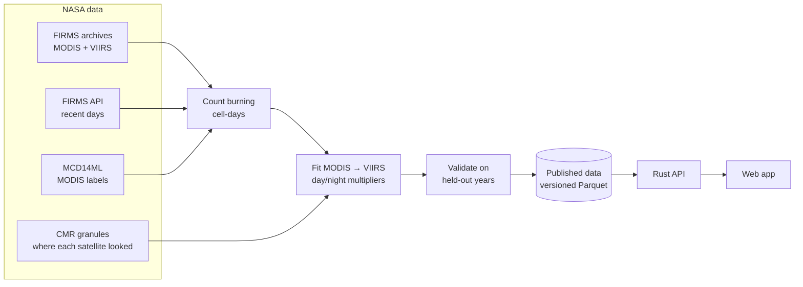
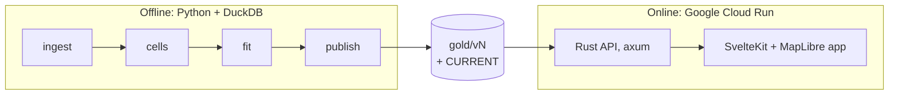

# firecal

**One unbroken fire calendar from 26 years of NASA satellite fire records.**

firecal harmonizes MODIS and VIIRS hotspots, so a change of satellite is no longer mistaken for a change in fire.

**[Open the live app](https://firecal-709583608801.us-central1.run.app)** · Data from November 2000 through 13 November 2026

NASA Space Apps Challenge 2026 · *Harmonization of MODIS and VIIRS Hot Spots* · Team Chiral Labs

> The first visit after a quiet spell takes about 15 s while the data loads.

---

## The problem

- **Two generations of satellites.** MODIS (Terra and Aqua) has watched for fire since 2000; VIIRS (S-NPP, then NOAA-20) since 2012.
- **Different eyes.** VIIRS's 375 m pixels report about 5× as many hotspots as MODIS's 1 km pixels for the same fires.
- **A false jump.** A raw 2001–2025 hotspot series leaps in 2012. That is a new instrument, not more fire.

## How it works



1. **Count the same way.** Burning cell-days on an H3 hexagon grid, by local solar date, day and night separately. This removes most of the pixel-size difference.
2. **One satellite per day, never summed.** Terra from November 2000, Aqua from August 2002, S-NPP from February 2012, then NOAA-20.
3. **Convert MODIS to VIIRS.** Day and night multipliers fitted on 2013–2022, only where both satellites actually observed the same place at the same time. Globally, each continent has its own fit.
4. **Test honestly.** Leave one year out, predict it, score it. Every method change is kept or rejected by rules fixed in advance ([PREREGISTRATION.md](PREREGISTRATION.md)).

**Results (Argentina, on years the model never saw):** typical error of the converted monthly count is **9.95 %** for the whole study area and **22.2 %** for 2° × 2° blocks.

## What the app does

| | |
|---|---|
| **Pick an area** | Draw a box or polygon, type coordinates, or choose a preset fire region |
| **Answer first** | "August 2020: 9.9× the usual August, 2nd highest of 26 years" |
| **Month in progress** | Days 1–D compared with days 1–D of earlier years |
| **Calendar and charts** | Years × months heatmap, fire season year by year, yearly totals, raw counts per satellite |
| **Trend** | Theil–Sen slope with a Mann–Kendall test, on converted counts |
| **Map over time** | A time bar animates the map month by month |
| **Downloads** | Monthly and per-hexagon CSV, charts as PNG/SVG, shareable links. The hotspot CSV works on the Argentina data when run locally |

## Quick start

Needs [mise](https://mise.jdx.dev) (it installs the pinned Node, pnpm, Rust, uv and Python) and the NASA data in `data/`. [docs/running.md](docs/running.md) covers getting the data, recent days, the global run and deployment.

```bash
mise install        # pinned tools
mise run setup      # frontend and pipeline dependencies
mise run granules   # NASA granule records (once)
mise run data       # build the published data
mise run web:build  # build the frontend
mise run api        # serve the app at http://127.0.0.1:8080
```

Before a pull request, run every check (about half a minute):

```bash
mise run check
```

It builds everything, runs the pipeline on a small sample, compares the Rust API with an independent Python reference, and runs the browser tests, on the sample, the Argentina data and a global sample.

## Architecture



- **Python writes the data, Rust only reads it.** The model is applied once, when publishing, so the app cannot disagree with the validation.
- **The FIRMS key never reaches the repo, the API or the browser.** It lives in a git-ignored `.env`, read only by the download step.
- **One image.** The `Dockerfile` packs the API, the frontend and the published data; `APP=global` (the live app) or `APP=argentina` picks the data set.

## Repository

| Path | What's there |
|---|---|
| [`pipeline/`](pipeline) | Python + DuckDB pipeline and the Python reference implementation |
| [`api/`](api) | Rust API |
| [`web/`](web) | SvelteKit app and browser tests |
| [`science/`](science) | Rule checks behind the method |
| [`global/`](global) | Configuration for the global run |
| [ARCHITECTURE.md](ARCHITECTURE.md) | System design, and where each challenge objective is met |
| [PREREGISTRATION.md](PREREGISTRATION.md) | Rules for judging any change to the method, fixed in advance |
| [docs/api.md](docs/api.md) | API contract |
| [docs/running.md](docs/running.md) | Full setup, checks and deployment |
| [AI_LOG.md](AI_LOG.md) | How AI tools were used, session by session |

## AI use

This project's code, documentation, tests and analysis were written with AI assistance (Claude Code, by Anthropic), and the published data is produced by that code. The team set the goals, made the decisions and checked the results. Every session is recorded in [AI_LOG.md](AI_LOG.md); the app says so in its Methods panel and in the page's `ai-disclosure` metadata.

## Credits

- **Fire data:** NASA FIRMS active-fire archives: MODIS MCD14ML Collection 6 and 6.1 (Terra and Aqua) and VIIRS 375 m Collection 2 (S-NPP and NOAA-20). MODIS hotspot types for 2000–2017 from the MCD14ML Collection 6 version 3 files of the MODIS fire team, University of Maryland (Giglio, L., Schroeder, W. & Justice, C. O. (2016), The Collection 6 MODIS active fire detection algorithm and fire products, *Remote Sensing of Environment* 178, 31–41). NASA data, shared without restriction under the [EOSDIS Data Use and Citation Guidance](https://www.earthdata.nasa.gov/data/catalog/lancemodis-mcd14dl-6.1nrt).
- **Basemap:** [OpenFreeMap](https://openfreemap.org/) tiles, © [OpenMapTiles](https://openmaptiles.org/), data © [OpenStreetMap](https://www.openstreetmap.org/copyright) contributors.
- **Map libraries:** MapLibre GL JS (BSD-3-Clause), deck.gl (MIT), Terra Draw (MIT), h3-js (Apache-2.0).
