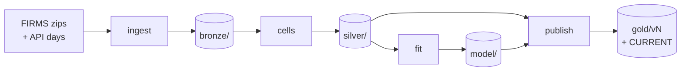

# Running firecal

The full setup: data prerequisites, the pipeline, recent days, the global run, checks and deployment. The [README](../README.md) has the short version.

- [1. Prerequisites](#1-prerequisites)
- [2. Build and run (Argentina)](#2-build-and-run-argentina)
- [3. Recent days from the FIRMS API](#3-recent-days-from-the-firms-api)
- [4. The global run](#4-the-global-run)
- [5. Frontend work](#5-frontend-work)
- [6. Checks](#6-checks)
- [7. Deploy to Google Cloud Run](#7-deploy-to-google-cloud-run)

## 1. Prerequisites

Requirements: [mise](https://mise.jdx.dev), which installs the pinned Node, pnpm, Rust, uv and Python from `mise.toml`, plus the FIRMS yearly "all countries" archives (`modis_YYYY_all_countries.zip`, `viirs-snpp_…`, `viirs-jpss1_…`) in `data/`, plus the MODIS labels and granule records below.

### MODIS labels

**MODIS labels.** FIRMS's MODIS archive carries older (version-2) hotspot type labels through 2017, so the pipeline takes the labels for 2000–2017 from the producer's version-3 monthly files (PREREGISTRATION.md §7). They are NASA data from the MODIS fire team's server at the University of Maryland, about 1.3 GB, reached by SFTP with the login the team publishes in its [user guide](https://www.earthdata.nasa.gov/s3fs-public/2023-09/MODIS_C6_C6.1_Fire_User_Guide_1.0.pdf). Section 4.3, "University of Maryland SFTP Server", gives the login:

```bash
mkdir -p data/mcd14ml
sftp -o IdentityAgent=none -o PubkeyAuthentication=no fire@fuoco.geog.umd.edu
# at sftp>:  cd data/MODIS/C6/MCD14ML   lcd data/mcd14ml
#            get MCD14ML.200*.006.03.txt.gz   get MCD14ML.201[0-7]*.006.03.txt.gz   bye
```

`ingest` stops with an error if a year's files are missing, or if under 99.9 % of FIRMS rows find their label.

### Granule records

**Granule records.** The fit uses only places and times both satellites actually observed (PREREGISTRATION.md §7). Which ones those are comes from NASA's public records of each satellite's 5- and 6-minute swath slices ("granules"), downloaded once with `mise run granules`: about 600 requests to NASA's Common Metadata Repository, no login, roughly 10 minutes, saved to `data/granules/`. `cells` stops with an error if a month is missing, or if more than 0.1 % of a satellite's detections fall outside its recorded footprints.

## 2. Build and run (Argentina)

```bash
mise install        # the pinned tools
mise run setup      # frontend and pipeline dependencies
mise run granules   # NASA granule records for the fit (once)
mise run data       # build the published data (about a minute for Argentina)
mise run web:build  # build the frontend
mise run api        # build and run the API, which serves the app: http://127.0.0.1:8080
```

`mise tasks` lists every task. The pipeline steps behind `data` are `ingest` (zips, plus any recent days from `download` → `data/bronze/`), `cells` (burning cell-days, and the places and times each satellite observed → `data/silver/`), `fit` (multipliers and validation → `data/model/`) and `publish` (→ `data/gold/vN/`, and `data/gold/CURRENT`).



**Without mise:** each task in `mise.toml` is a plain command you can run yourself, for example `cd pipeline && uv run python -m firecal_pipeline all`.

## 3. Recent days from the FIRMS API

**Recent data (optional).** The zips end with `last_year` in `firecal.toml`. To add the days since, up to two days ago:
1. Get a free [FIRMS MAP_KEY](https://firms.modaps.eosdis.nasa.gov/api/map_key/).
2. Put it in `.env` at the repo root (`cp .env.example .env`; `.env` is git-ignored).
3. Run `mise run refresh`. It downloads the new days, rebuilds and publishes a new data version (a running API switches to it within 10 seconds), and deletes all but the newest three versions (`keep_versions` in `firecal.toml`; each is about 190 MB). Each run's log is in `data/logs/`.

`download` writes one CSV per product and UTC day to `data/firms_api/`: standard-processing data where FIRMS has it, near-real-time after that. Running `refresh` again brings the series up to date. It fetches only new days, the last few near-real-time days again, and days whose standard-processing version has since appeared. The key is used only in the requests to FIRMS; mise does not load `.env`. When the series ends partway through a month, the app compares that month so far with the same days in earlier years.

## 4. The global run

**Global run.** `global/firecal.toml` runs the same pipeline over every country, with each continent fitted and judged as its own study area (`global/continents.toml`; PREREGISTRATION.md §4 and §7). It reads the same FIRMS zips and MODIS label files and writes to `data/global/`. The Argentina app is unaffected.

```bash
cd pipeline
FIRECAL_ROOT=../global uv run python -m firecal_pipeline granules   # about an hour, once
FIRECAL_ROOT=../global uv run python -m firecal_pipeline download   # recent days, VIIRS only; ~50 min from January, minutes after
FIRECAL_ROOT=../global uv run python -m firecal_pipeline ingest
FIRECAL_ROOT=../global uv run python -m firecal_pipeline cells
FIRECAL_ROOT=../global uv run python -m firecal_pipeline fit
FIRECAL_ROOT=../global uv run python -m firecal_pipeline report     # rule statuses with luck ranges → data/global/model/report.json
FIRECAL_ROOT=../global uv run python -m firecal_pipeline tilt       # tilt correction test (rejected) → data/global/model/tilt_report.json
FIRECAL_ROOT=../global uv run python -m firecal_pipeline seasonal   # seasonal multipliers test (kept, not Europe) → data/global/model/seasonal_report.json
FIRECAL_ROOT=../global uv run python -m firecal_pipeline publish    # → data/global/gold/vN/ and gold/CURRENT, about 30 s
```

A `silver/` built before coverage was split by continent needs `FIRECAL_ROOT=../global uv run python -m firecal_pipeline coverage` (seconds) before `publish`; `publish` says so.

### Global recent days

**Global recent days.** `download` fetches the days after December 2025 for the whole world, one box per request, VIIRS only (`api_products`). FIRMS counts about 36 transactions per world-day against the key's 5,000 per 10 minutes, so the first download from January is about 22,500 transactions: roughly 50 minutes, paced to stay under 95 % of the limit. Later runs fetch only new days; `FIRECAL_ROOT=global scripts/refresh.sh` runs download, ingest, cells, publish and prune for the global data. `download --sample YYYY-MM-DD` probes 5 days and prints their time and cost. API rows carry no country, so `ingest` gives each the continent its place had most often in the archive (PREREGISTRATION.md §7).

### Global app

**Global app.** The same app over the whole globe, from November 2000 to the latest complete day, with the month in progress compared with the same days of earlier years. No hotspot CSV (about 580 M detections, 6–8 GB; `hotspot_export = false` in `global/firecal.toml`; the API refuses it with a message and the app hides the button). Build the frontend once, then serve the global data:

```bash
mise run web:build
mise run api:global       # http://127.0.0.1:8080, from data/global/gold/CURRENT
```

How the continents work (`docs/api.md` has the exact rules):
- Every fire-day is converted with its own continent's multipliers, and each day's satellite is chosen per continent (the first in the era's chain with any detection in that continent that day).
- A search takes the error ranges and the days with data of the continent holding most of its fire-days over the whole series; the app says which continent and its share, and the Methods page shows that continent's scores and gaps. A search with no fire uses the whole globe's days with data.
- Antarctica (with Heard Island) has too few fires to fit: its MODIS days, before February 2012, have no data rather than unconverted counts, and its VIIRS days use the whole globe's satellite choice.

Sizes, measured on data v2: the published data is about 400 MB (monthly rows: 6.0 M at level 4, 17.6 M at level 5, 44.4 M at level 6). The API keeps all three levels in memory: it starts in about 10 s and holds about 1.8 GB (2.5 GB while loading; twice that briefly when it swaps in a new version). Searches take a few milliseconds, and about half a second for a continent-sized box.

The `report` step also works on Argentina (`uv run python -m firecal_pipeline report`).

## 5. Frontend work

`mise run web:dev` serves the app with live reload and sends its API requests to the API on :8080, so run `mise run api` alongside it. The app has no data of its own.

## 6. Checks

With the API running, `mise run parity` sends the same requests to the Rust API and to the Python reference implementation and compares the answers. `mise run web:test` runs the browser tests against it (after `mise run web:build`): they load the app and check every number on screen against the API's answer for the same request.

Before a pull request, run all checks:

```bash
mise run check      # or scripts/check.sh
```

It runs everything on this machine, in about half a minute:
1. Type-checks and builds the frontend.
2. Builds the API.
3. Runs the whole pipeline on a small sample, then compares the API with the reference on it and runs the browser tests against the API serving the app.
4. Does both again on the full published data.
5. Does both again on a small sample of the global data (`pipeline/tests/fixture_global/`, cut from `data/global/gold` by its `make_sample.py` in seconds; skipped if there is no global data).

The sample is real FIRMS rows for a small box near the Paraná Delta, including recent near-real-time days. It's built from your local `data/` the first time (`--fresh-sample` rebuilds it) and is git-ignored, so no fire data goes into the repo. The pipeline and the API both read `FIRECAL_ROOT` to find it (`pipeline/tests/fixture/`). The script exits non-zero if any check fails.

## 7. Deploy to Google Cloud Run

One image holds the API, the built frontend and the current published data for both data sets; the `APP` environment variable picks which one a container serves (`global` is the live app; `argentina` also works). `.gcloudignore` uploads only the files the `Dockerfile` copies (no `.env`, no raw data). Update the two version names in `.gcloudignore` and `.dockerignore` after publishing a new version.

```bash
mise run web:build
gcloud builds submit --tag us-central1-docker.pkg.dev/PROJECT/firecal/app:TAG --machine-type=e2-highcpu-32 .
gcloud run deploy firecal --image=us-central1-docker.pkg.dev/PROJECT/firecal/app:TAG --region=us-central1 \
    --memory=4Gi --cpu=2 --cpu-boost --max-instances=2 --set-env-vars=APP=global --allow-unauthenticated
```

On a new project, Cloud Build runs as the default compute service account, which needs the Cloud Build Service Account role (`roles/cloudbuild.builds.builder`) to read its source and push the image.
